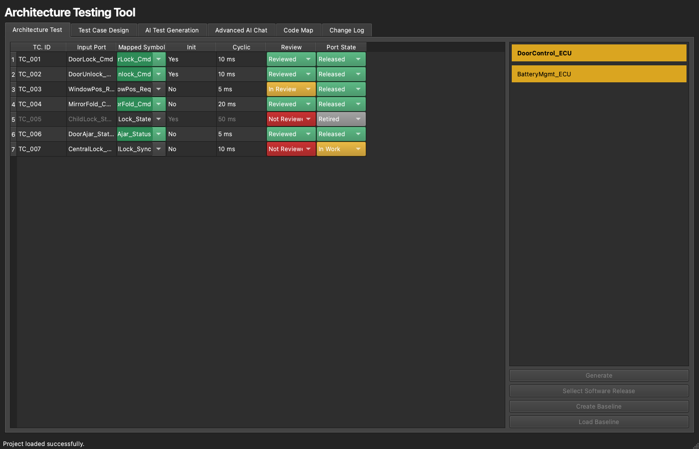
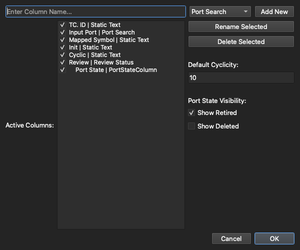
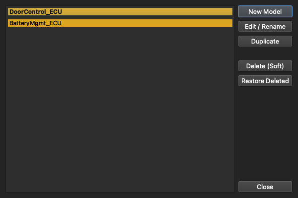

# 2. The Workspace

[← Getting Started](01-getting-started.md) · **The Workspace** · [Next: Importing Architecture →](03-importing-architecture.md)

---

The **Workspace** is the architecture-validation matrix and where most of the work happens. Your ports are laid out as rows, your data as columns, and the left-hand sidebar lists the architecture models and the active release.

> 💡 Want a guided tour? **Preferences → Tutorials → Workspace & architecture matrix** runs through this view interactively.

## Anatomy of the screen

- **The sidebar (left)** — the architecture **models** in the project and the **release** picker. Click a model to load it; the matrix reloads to show it.
- **The scope bar (top)** — a **Search ports…** box, a **Filter ▾** menu, **Re-match Symbols**, and **＋ Add Port**.
- **The matrix (centre)** — one row per port/interface, one column per piece of data you're tracking.
- **The inspector (bottom)** — actions for the selected port: pick a match, show it in the Code Map, view **Port history…** / **Model history…**, duplicate, or retire.
- **The status bar** — the active model and release, total ports, and how many are reviewed.

## Fuzzy symbol matching

When a release's ELF is loaded, search-type columns match each port against the real function and variable names pulled from the binary, using fuzzy string matching with a **configurable confidence threshold**. Each match shows the resolved symbol and a confidence score, colour-coded so a strong match reads green and a weak or missing one reads amber/red. You stay in control: accept the proposed match, pick a different candidate from the match picker, or override it by hand. Click **Re-match Symbols** after importing a new build to re-link every port; cells you've touched by hand aren't silently overwritten.

**Macros count too.** Generated configuration code often provides its accessors as `#define` macros, for example `#define cfgGetRLMaxValueForHigh_u16() (…)`. The preprocessor replaces them before compiling, so they are never in the ELF, but they are real call targets and the Code Map shows them. Once the release's source is imported, its macros are offered as candidates as well: function-like macros alongside functions, other macros alongside variables. The match picker tags them **macro**. When an ELF symbol has the same name, the ELF symbol is used.

Anything shown in the release's [Code Map](09-code-map.md) call tree can be matched too, even when its definition wasn't found. That happens when a header was never imported: the importer skips build-output folders such as `out` or `build`, where generated configuration headers often live. These candidates are tagged **call tree**. Importing source into the active release re-matches the table automatically; cells you picked by hand are kept.

## Column types

The matrix is fully customizable, and each column has a *type* that defines how it behaves:

| Column type | What it's for |
|-------------|---------------|
| **Port / Function / Variable Search** | Fuzzy-matches the port against symbols of that kind from the ELF |
| **Static Text** | Free-text or read-only data (e.g. a matched symbol name) |
| **Init / Cyclic** | Shows whether a matched function runs at init time and/or cyclically |
| **Review Status** | A drop-down: *Not Reviewed* / *In Review* / *Reviewed* |
| **Port State** | A drop-down: *Released* / *In Work* / *Retired* / *Deleted* |
| **Last Result / Release Result** | Per-release validation outcomes (see [Releases & Baselines](04-releases-and-baselines.md)) |
| **Link** | Cross-references between rows |
| **Call-tree Test** | Per-release automated check: is the matched function actually called? (see below) |

Review Status and Port State are colour-coded so the state of every port is readable at a glance — reviewed rows go green, unreviewed rows red, retired ports grey out, and so on.

## Customizing columns

Open the **Columns** toolbar icon to add, remove, reorder, rename, and show/hide columns by drag-and-drop:

A few rules keep things consistent: `TC. ID` always stays first, and once a row has been **Reviewed**, the columns holding its reviewed data are locked so they can't be deleted out from under a sign-off. You can also choose whether *Retired* and *Deleted* ports stay visible (via the **Filter ▾** menu).

## Call-tree Test columns

A **Call-tree Test** column checks, for every port, whether the function in a chosen Match column is really used by the model's module in a release's firmware: it follows that release's [Code Map](09-code-map.md) call tree down from the model's **main function** and records a verdict.

**Adding one.** In **Columns**, click **＋ Test column…**, pick the **Match column** to test and the **release**, then **Add** and **Apply**. You can add one per release and Match column, so with several Match columns you choose which one each test checks. Tick **verified calls only** to count only calls confirmed by the release's imported `.o` files.

**Running it.** Tests run only when you start them: click **▶** in the column header (shown while the column's release is active). Build the release's Code Map first (one map serves every model of the release); without one the rows report *No Data*.

**Main function.** The first time you run a test for a model, a pop-up asks for the model's **main function**: the function the module starts from, for example its cyclic `rlsAppl()`. Search the call tree and pick it, or take one of the suggestions (the functions that reach the most of the model's port functions). Add more than one if the module has several entries, such as an init function, the cyclic function and an interrupt. The choice is saved for the model and used in every release. It is asked again only when none of them is in the release's call tree (for example after a rename). Change it any time with **ƒ** in the column header. Every change is logged in the model history.

| Verdict | Meaning |
|---|---|
| **Passed** | A main function reaches it, directly or through any number of calls (main → function 1 → function 2 → tested function). The cell keeps that call path. |
| **Failed** | No main function reaches it. The reason names the functions that do call it (outside the module's call tree), or says nothing calls it. |
| **Entry point** | Only set by hand (or recorded by older versions, before main functions): the function is started by the OS, scheduler or startup code. |
| **Not Matched** / **No Data** / **No Result** | The Match cell is empty, or the matched name isn't in the call tree / there is no code map for the release, or none of the main functions is in it / the port is Retired or Deleted. |
| **Not Run** | The test hasn't been run yet. |

Calls made from **assembly** (for example a bootloader's start-up code calling a low-level init) are not visible in the C source. Import the release's `.o` files, including the assembled start-up objects, in the Code Map's **Objects** badge and those calls count as real callers.

**Parameter ports.** Some ports are a parameter rather than a function. To test one, add a **Variable Search** column with `required` or `provided` in its title, such as *Required Parameter*, to the right of the function column, then bind a Test column to its Match column. The title sets the direction:

| Title has | The value... | Passed when the row's function, or a function it calls, ... |
|---|---|---|
| `required` | comes in | has it as a parameter, or reads it |
| `provided` | goes out | returns it, writes it, or stores it through an output pointer |

No main function is needed, because the test starts from the row's function. The direction comes from the source, so build the Code Map from source first. Using the variable the wrong way round gives **Failed** with "Wrong direction". A name that isn't a variable in the release, or whose match scores below 70%, gives **Not Matched**. Generated names rarely match exactly, which is why that limit is lower than for functions. A title with neither word gives **No Data**, and a row with nothing in that column gives **No Result**, so one port can use a required and a provided column without the other counting against it.

Import the release's `.o` files as well and their data relocations name every variable a function references. An access the source also shows is marked as confirmed by the object file. One it doesn't show, such as a macro that hides the variable, or assembly, gives **Passed** with a note that the direction isn't confirmed, because a relocation can't tell a read from a write. With object files and no source, every result is like that. A variable reached only through a pointer stored elsewhere, such as in a table of pointers, isn't seen either way. Object files imported before version 3.1.1 need importing again.

**Size limits.** The C source analysis has no limit on file size, function length or the number of variables in a function, so a large generated function is analysed in full. A parameter test follows up to 5000 of the functions a port's function calls, closest first, and a **Failed** result says when it stopped there. A model can have 10 main functions, and the HTML report lists 25 callers per port with the total next to them.

**Recorded, not live.** A verdict is stored with its evidence and the time it was run, so it doesn't change silently. If the Code Map is rebuilt afterwards, the cell shows **⟳** (stale) until you run the test again.

**HTML report.** Click **⎙** in the column header (shown while the column's release is active, also in view-only mode) to save a report of the column as a **single HTML file**: everything (styles, script, diagrams) is inside it, so it opens in any browser and can be attached to a review. It starts with your logo (top right, if you set one), the project, release, Test column, the operator and the date. Next comes an **overall results** table: how many test cases Passed, were Entry points or Failed, each with its share, and the **overall score**. Then a table of the **architecture models**, each with its main function, its own counts and score (click a model to jump to it), and one chapter per model listing every row with a result in a table (rows never run and Retired/Deleted ports are left out). Under each model's results comes its **call tree from the main function**: like an IDE call hierarchy, but showing only the calls that lead to the model's ports, with each port's verdict next to its function (click to open it, or collapse a branch). Below it, a table lists the ports the main function does not reach. The score is the share of results that are *Passed* or *Entry point*; *Not Matched* and *No Data* rows count against it. Click an entry to open its detail page: the reason for the verdict, the call path from the main function, the callers recorded when the test ran (✓ = confirmed by `.o` files), any manual override (who, when and what the tool said), a stale warning if the Code Map was rebuilt since, and a snapshot of the call tree around the function: the shortest call path from a function nothing calls, and the caller and callee trees a few levels deep. In the desktop app you choose where to save it; in a browser it downloads.

**Logo.** In **Preferences → Reports**, click **Choose image…** and pick a PNG, JPEG, GIF, WebP or SVG file (up to 1 MB). The image is embedded in every report you save from then on, in the top-right corner of the header. **Remove** takes it out again. Like the operator details, it is saved for your user on this computer.

**Operator details.** In **Preferences → Reports**, fill in the details the report header should show, such as your name, email or team. You can rename, add or remove fields. They are saved for your user on this computer, not in the project. With nothing filled in, the report shows the computer's user name as the operator.

**Manual verdicts.** While the column's release is active and not baselined, a tester can click a verdict and set it to *Passed*, *Failed* or *Entry point*, for example to accept a function the tool can't see being called. The cell shows **✎**, the tooltip keeps the tool's own verdict, re-running never overwrites a manual verdict, and **Reset to tool verdict** undoes it. Every run and every manual change is recorded in the history. Once the release is baselined, its test results are frozen.

## Port states & propagation

Moving a model out of **In Work** doesn't cascade silently. When a model's state changes, a confirmation lists the ports still marked *In Work* and lets you **choose exactly which ones follow** the model's new state — so a state change is always a deliberate act.

## Working with multiple models

A single project can hold several architecture models — for example one per ECU or per software component. The model manager lets you create, rename, duplicate, soft-delete, and restore them:

**Soft-delete** means a removed model isn't gone — it's hidden and can be restored later, so you never lose history by tidying up.

---

[← Getting Started](01-getting-started.md) · [Guide home](README.md) · [Next: Importing Architecture →](03-importing-architecture.md)
