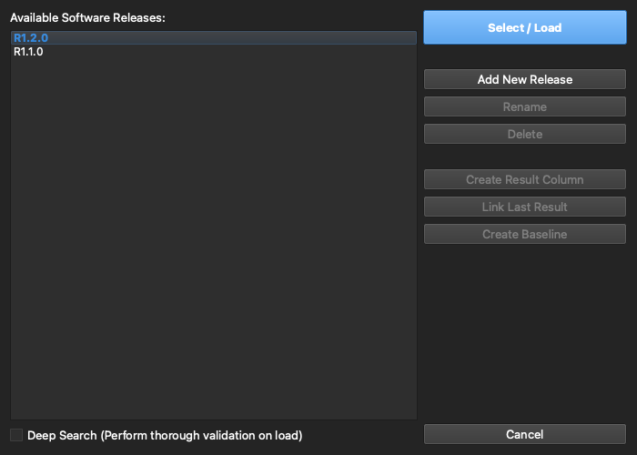

# 4. Releases & Baselines

[← Importing Architecture](03-importing-architecture.md) · **Releases & Baselines** · [Next: Test Design →](05-test-case-design.md)

---

Firmware evolves, and so does the architecture that maps onto it. Releases and baselines are how Architecture Validator Pro keeps validation honest across that change.

## Software releases

A **release** represents one software build, and carries its own ELF binary data and (optionally) its C source. A project can hold many releases at once. Open the **release picker** in the Workspace sidebar, or the full **Release Manager** from the gear next to it:

From here you can:

| Action | What it does |
|--------|--------------|
| **Activate** | Make a release active — the matrix re-matches against that build's symbols |
| **Add release** | Bring in another ELF as a new release |
| **Rename / Delete** | Manage the release list |
| **Symbols…** | Manage the release's symbol files — one per component (see below) |
| **Map / Import Source** | Attach a C source folder to the release (stored in the project, keyed by release) |
| **Branch** | Create a new editable release from an existing one |
| **Result column** | Add a per-release validation-result column to the matrix |

Only the active release is held in memory, so projects with many large ELF builds stay responsive. Source is imported **once** and stored inside the `.arch` keyed by release — everywhere that used to need a folder picker (Code Map, Change Log, AI) now just reads from a release dropdown.

## Several symbol files per release (FBL, APP, …)

One release can hold **several symbol files**, one per component, for example the bootloader (**FBL**) and the application (**APP**), each built into its own ELF / Renesas `.out` / `.abs` / `.axf` image (a `.json` symbol cache works too). Click **Symbols…** on the release in the Release Manager:

- **Add Symbol File…**: type a component name (left empty, the file's name is used) and pick the file. It is parsed in the background and added to the release.
- **Replace…**: import a new build for that component; it keeps its place in the list.
- **Rename** / **Remove**: rename a component, or detach its file. A removed file's symbol data is deleted from the project once no other release or baseline still uses it.

Everything that reads symbols uses **all of a release's files together**: the Match picker (each candidate shows which component it comes from), **Re-match**, the [Code Map](09-code-map.md) (a function's details show its component) and the call-tree Test columns. If the release is active, adding or removing a file re-matches the table automatically.

**Same name in several components.** Names such as `main` or a driver compiled into both images (`Can_Init`) appear once. The entry takes its address, size and signature from the **first** component in the list (marked *primary*) and gets the call edges of **every** component that defines it, so the call tree is the union of all images. The dialog shows how many functions of each file are shared with an earlier one.

Every add, replace, rename and remove is written to the change history. Branches and baselines take a copy of the release's component list; a frozen baseline's list can't be changed. Projects created before this feature open with their single file as one component named **Main**, which you can rename.

## Baselines

A **baseline** is an immutable snapshot of a release at a point in time — your reference of record. Creating a new release **auto-baselines** the previous one. A baseline is read-only and **write-protected at the database layer** (not just in the UI); **unfreezing** it requires the project master password, and every freeze/unfreeze is recorded in history. When you're viewing a baseline, a banner makes the read-only state clear and offers a one-click way out.

## Change detection

This is the payoff. **Compare** the active data against a baseline, and changed rows are flagged so a new software release can't quietly drift away from your reviewed architecture without someone signing off.

The per-release **result** columns build on this: each release gets its own column recording whether each port validated — *Pass*, *Block*, *No Result*, or *Not Run* — and the *Last Result* column rolls the latest outcome up so you can see current status without hunting through history. It's an ASPICE-style, single-column verdict an auditor can scan.

---

[← Importing Architecture](03-importing-architecture.md) · [Guide home](README.md) · [Next: Test Design →](05-test-case-design.md)
