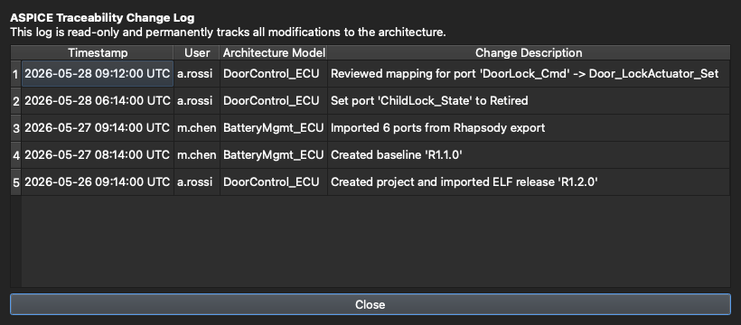

# 6. Collaboration & Safety

[← Test Design](05-test-case-design.md) · **Collaboration & Safety** · [Next: AI Test Generation →](07-ai-test-generation.md)

---

Architecture data is often shared across a team and used for sign-off, so the tool has several features dedicated to not losing work and not stepping on each other.

## Edit modes & file locking

As covered in [Getting Started](01-getting-started.md), a project is opened either **view-only** or **for editing (exclusive)**:

- Opening **for editing** acquires a lock on the project file.
- Anyone else who opens it sees that it's locked and **who holds the lock**, and can still open it view-only to browse safely.
- If the lock was left behind by a session on another PC that has stopped, try to open the project for editing, keep the app open, and try again after about 10 minutes. The app frees the lock once it has seen no heartbeat from that session for that long, measured on your own PC. On a shared project, the Sync Worker has usually done this watching already (see below).
- A banner appears if the lock is lost (e.g. taken by another user) — the session drops to view-only so you can't clobber their work.

View-only isn't just a disabled toolbar: it's enforced **server-side** (the worker opens the database read-only), so a browsing session physically cannot write.

## Sharing a project on a NAS

A team can keep a project on a network share. The **Sync Worker**, a small separate applet with a tray icon (a menu bar icon on macOS), keeps your local copy and the shared copy in step. You work from your own disk, and only the changed parts travel.

The Sync Worker doesn't need the app. Turn on **Start at login** in its menu, and it quietly keeps your shared projects current in the background from the moment you sign in. The icon changes colour only when a project needs you.

- **To share a project**, click the sync entry in the status bar and choose **Save to a shared folder…**. A project created on a network path is shared straight away. For a database someone copied there by hand, use **Add database…** in the Sync Worker, or simply open it.
- **Edit:** opening for editing locks the shared project under your name and brings your copy up to date first. Other users can still view it.
- **Publish:** **Save** sends your changes. Teammates then never receive half-finished work. A finished overnight build run publishes by itself.
- **Receive:** changes from others arrive by themselves within about 30 seconds, whether or not the app is open. If the project is open, the app shows **Syncing changes from** and the user's name while they're applied.
- **Close:** the lock is released once your last changes have been published. The Sync Worker finishes this even if the app has closed.

### What changed, and by whom

Click **Open Sync Worker…** in the tray menu to see your shared projects and each one's changes, such as `alex → Release 2.1 → Code Map`, filtered by section. This is kept in the Sync Worker so that it doesn't clutter the app or the ASPICE change history, and it works with the app closed.

### A lock left behind by a crash

If someone's PC stops while they're editing, their lock stays behind. A live session updates its lock every minute, so the Sync Worker can tell how long a lock has been silent. After 10 minutes of silence you can open the project for editing straight away. Nobody has to wait, and a wrong clock on either PC can't free a lock that's in use. Without the Sync Worker running, the app has to watch the lock itself for those 10 minutes.

What happens when something goes wrong:

| Situation | What you'll see |
|---|---|
| The NAS can't be reached while viewing | You keep working from your copy, and the status bar shows when it last synced. |
| The NAS can't be reached while editing | The session stays open, and your edits are published when it comes back. |
| Someone took over after you were offline for more than 10 minutes | Your work is saved next to the shared project as `Project (conflict <user> <date>).arch`, and your session becomes view-only. Nothing is merged automatically. |
| The shared copy is damaged | Sync stops for that project. **Republish from this copy** replaces it from your complete local copy, and the damaged file is kept beside it. |
| PCs run different app versions | Sync stops for that project until everyone has updated. |

Encrypted projects sync too. The Sync Worker copies stored values as they are, so it never sees your master password.

**Stop tracking** in the Sync Worker removes a project from the list and leaves both copies in place. **Sync now** checks straight away, and gives a stopped project another try once you've fixed what stopped it.

## Saving

Edits are kept in the open project and written to disk when you click **Save** in the title bar (enabled only in an editable session). Because the `.arch` is a single SQLite file with per-block content encryption, saves are fast — there's no decrypt-to-temp / re-encrypt-the-whole-file step.

## Master password & encryption

A project can be protected with a **master password**. The `.arch` is a plaintext SQLite container in which only sensitive content is encrypted, each category under its own key. The master password is required to open an encrypted project and to **unfreeze a baseline**. Legacy whole-file-encrypted projects are migrated to the current format automatically on first open.

## Change history (ASPICE-friendly)

Every modification to the architecture is recorded in a read-only **change log** — what changed, when, who did it, and in which model and release. Open it from the Workspace inspector with **Port history…** (for the selected port) or **Model history…** (for the whole model):

The log is **release-scoped**, obfuscated at rest, and protected by an **append-only HMAC hash-chain**, so edits, deletions, or reordering are detectable. That gives you the traceability process standards like ASPICE expect, without any extra bookkeeping on your part.

---

That's the core tour. The next chapters cover the AI, Code Map, Change Log, and Test Injection views. 🎉

[← Test Design](05-test-case-design.md) · [Next: AI Test Generation →](07-ai-test-generation.md)
