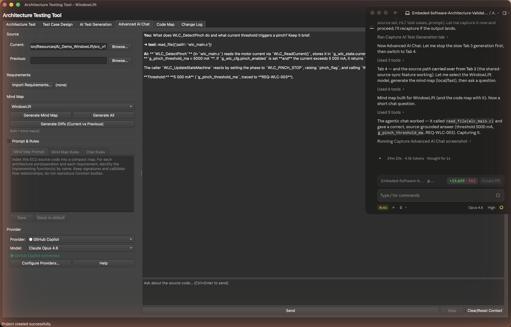

# 8. AI Chat

[← AI Test Generation](07-ai-test-generation.md) · **AI Chat** · [Next: Code Map →](09-code-map.md)

---

The **AI Chat** view lets you ask questions about your firmware and get answers grounded in the *actual* C source, not guesses. The agent reads the code with read-only tools, and every function or `file.c:123` it mentions is a link that opens the code next to the chat.

> 💡 **Preferences → Tutorials → AI Chat assistant** walks through it interactively.

## What you need

- A connected AI account (set up in **Preferences → AI Settings**, the same accounts as [AI Generation](07-ai-test-generation.md)).
- The release's **source imported** (Release Manager), so the agent can read the code.
- Optionally, a **Code Map and mind map** for the release (Code Map tab): the agent then knows the structure before it opens files. Rebuild them after the call-tree or mind-map changes of V3.3.0.

## The layout

Laid out like VS Code:

- **Left — explorer:** **Files** (the release's source tree), **Functions** (filterable) and **Chats** (this project's saved conversations).
- **Middle — the code:** files open in tabs, read-only, with the referenced lines highlighted. Select code and press **Ask about selection** to put it in the chat box.
- **Right — the agent:** the conversation, the credits bar, and the composer with the agent, model, effort and context pickers.

Drag the borders between the panes to resize them.

## Answers

Answers are rendered Markdown with tables and highlighted code blocks (with **Copy**). A function name in backticks, a `Name()` call or a `path/file.c:123` reference becomes a link: click it to open the file and highlight the function or lines. Each answer lists the **tools it used** (search, file reads, function look-ups). Click a read file or a function there to open it.

| Tool | What it does |
|------|--------------|
| `read_file` / `list_files` | Read a source file / list files of the release's source |
| `search_code` | Substring search across the source |
| `get_function` / `get_call_graph` | One function's details / its callers and callees (Code Map) |
| `get_mind_map` | The compact per-model index |
| `get_requirements` | Imported requirements |
| `get_diff` | The stored current-vs-previous diff |

Every tool is read-only and confined to the release's stored source.

## Models, effort and context

- **Model:** every configured account's models in one list. The chat remembers the last model and settings (per account too) across restarts.
- **Effort:** shown for models that reason (Copilot's reasoning models, OpenAI o-series/GPT-5, Claude 4+, Gemini 2.5+, Ollama thinking models).
- **Context:** for Ollama, the context window the model runs with (`num_ctx`, up to what the model takes). For other accounts, a cap on how much of the model's window the chat may fill. When the conversation outgrows it, the oldest messages are left out, and the answer says so.
- **⋯ settings:** turn the code tools or the mind map off, pick the mind map's scope (this model / whole project), and cap the answer length.

The ring next to **Send** shows how much of the context window the next request fills: rules and agent, mind map, tool definitions and conversation (hover for the split). After an answer, the hover also shows the size of the last request as the provider counted it, tool results included.

## Credits

The bar under the chat title shows the account's balance. For **GitHub Copilot**, that's the chat credits left this month and the reset date (**⟳** refreshes). OpenAI, Anthropic and Gemini are billed per token, and self-hosted Ollama/vLLM cost nothing. **This chat** shows what the conversation used: Copilot credits, tokens in and out, and the number of model requests. Each answer shows its own tokens too.

## Chat history

Every conversation is saved automatically, per project and per user. Chats are encrypted in your app-data folder, not in the `.arch`, so they work in read-only projects and colleagues don't see them. Open, rename (double-click) or delete chats in **Chats**; **＋ New** starts a fresh one. A chat reopens with the model and agent it last used.

## Editing, rolling back and retrying

Hover a message for its actions:

- **✎ Edit** on a prompt: change it, optionally pick another model, and send. The prompt and everything after it are replaced.
- **⟲ Roll back to here:** remove the prompt and everything after it. Its text goes back into the box.
- **↻ Retry** on an answer: ask the same question again, or pick **another model** from the menu next to it.

## Agents and rules

Agents and rules are set up the way VS Code's Copilot sets them up (**⚙** next to the agent picker):

- **Agents** (`.agent.md`): a name, a description, instructions, the tools it may use and an optional preferred model, which is picked when you choose the agent. The built-in agents are *Ask*, *Test Engineer* and *Code Reviewer*.
- **Rules** (`.instructions.md`): text added to every request, or only when the file open in the editor matches the rule's `applyTo` globs (e.g. `**/*.c`). **Project rules** apply to every agent (VS Code's `copilot-instructions.md`).

Agents and rules are saved in the project, so everyone on it shares them. **Import from folder…** reads a checkout's `.github/agents`, `.github/chatmodes`, `.github/instructions`, `copilot-instructions.md` and `AGENTS.md`. **Export to folder…** writes them back in the same layout.

---

[← AI Test Generation](07-ai-test-generation.md) · [Guide home](README.md) · [Next: Code Map →](09-code-map.md)
