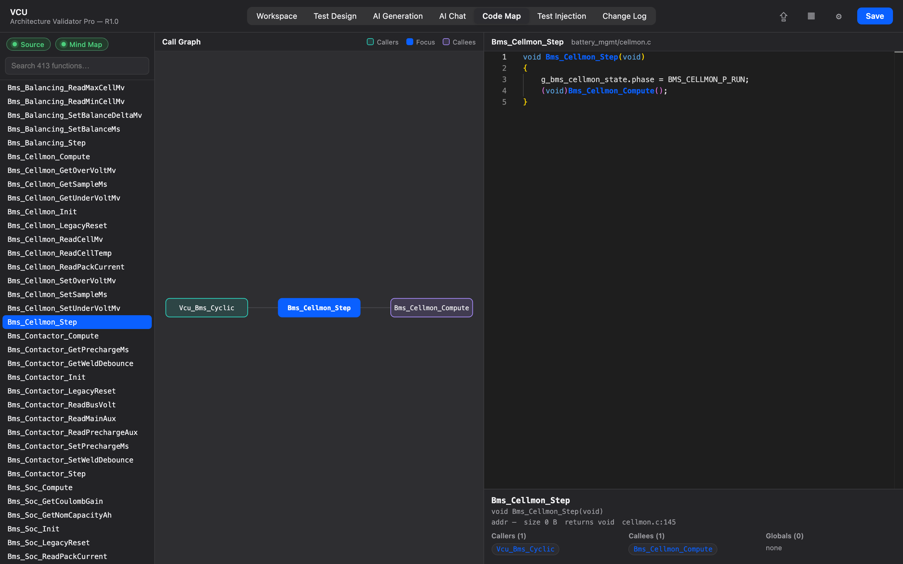

# 9. Code Map

[← AI Chat](08-advanced-ai-chat.md) · **Code Map** · [Next: Change Log →](10-change-log.md)

---

The **Code Map** is a visual explorer of your firmware's call graph plus a read-only IDE, joining what the compiled ELF knows (addresses, sizes, parameters, structs, globals) to your C source (which file defines each function, the call relationships, the body).

> 💡 **Preferences → Tutorials → Code Map & call graph** is an interactive tour.

## Where the data comes from

The map is built by joining two sources **by function name**:

- the **ELF / DWARF** facts from the loaded binary (verified addresses, sizes, parameter and return types, struct layouts, global types), and
- the **C source index** (which `.c` file defines each function, the caller/callee graph, and the body for the viewer).

The call-graph *edges* come from the source (DWARF has no call edges); the ELF side annotates each node with verified low-level facts. C++ names are demangled before matching. When a binary carries no call tree (stripped or relocatable objects often don't), the map falls back to the **source-derived** call graph automatically.

## Verifying the call graph with object files

Source-derived edges come from reading the C text, so they can include calls the compiler never built (inside a disabled `#ifdef`, for example). If you have the build-output **object files (`.o`)** for the release, the Code Map can check every edge against the compiler's own records.

1. Click the **Objects** badge in the sidebar and choose the build-output folder (all `*.o` files below it are scanned; each file is read once).
2. Rebuild the Code Map.

The graph then shows two kinds of edges, explained in the legend:

- **Solid (verified)** — the compiler emitted this call: a relocation in the object file names the target, or the debug info records the callee as inlined into the caller.
- **Dashed (source-only)** — seen in the source but not confirmed by the object files. Often an `#ifdef` that is disabled in this build. It can also be a call within one file that needed no relocation, so a dashed edge is a prompt to check, not proof of an error.

This works without disassembly, so it also covers targets the disassembler doesn't support (e.g. RH850). Objects built with **link-time optimization (LTO)** contain compiler intermediate code rather than machine code; they are listed as skipped instead of being imported.

The object files are an addition to the release, never a replacement for its ELF: addresses and sizes still come from the linked binary.

**Inlined functions.** When the optimizer inlines a function into its callers, the function often has no symbol of its own, so a debugger can't find it even though its code runs. The debug info still records every inline expansion; those functions are offered in the Workspace **match picker** tagged *inlined* (no address), so a port isn't flagged as missing just because its function was inlined.

## Building / refreshing it

A Code Map is produced when you build the mind map in [AI Generation](07-ai-test-generation.md) with source imported for the release — it re-indexes the source and rebuilds the map **offline, with no AI tokens**. If no map exists yet for the selected model/release, the view points you to generate one.

## Using the view

- **Sidebar** — status badges for whether **Source**, a **Mind Map** and **Objects** (`.o` files) are loaded, a function **search**, and the function list. Click a function to **focus** it.
- **Call graph (centre)** — the focused function sits in the middle; **Callers** are on the left, **Callees** on the right, colour-coded. Click any node to **re-center** on it and walk the tree node by node.
- **IDE panel** — the focused function's source, read-only and syntax-highlighted. Hover a symbol for its signature or `#define` value; **Ctrl-click** (Cmd-click on macOS) a symbol to focus it. A details card summarizes its callers and callees.

Source is read through the same sandboxed reader as the AI tools, so the viewer can only read files under the project's source root.

---

[← AI Chat](08-advanced-ai-chat.md) · [Guide home](README.md) · [Next: Change Log →](10-change-log.md)
