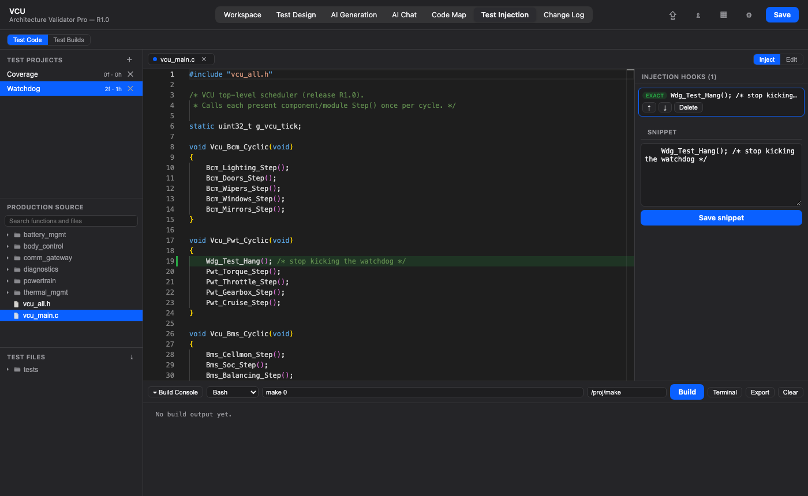

# 11. Test Injection

[← Change Log](10-change-log.md) · **Test Injection** · [Next: Test Builds →](12-test-builds.md)

---

The **Test Injection** view lets you add extra C code — instrumentation, stubs, a test harness — to your firmware **without ever editing the real source files**. Your code is saved in the project as *hooks* and only applied to generated copies, so your originals stay clean.

> 💡 **Preferences → Tutorials → Test Injection workflow** runs through the whole flow on a simulated screen.

## How it works

A **hook** is a snippet of C tied to a place in a source file. It remembers the **lines of code around that place, not a line number**, so it finds its spot again when the source shifts in a later release. Nothing is written to the real file.

Each hook shows how sure the app is about its place:

| Badge | Meaning |
|---|---|
| **exact** | The code on both sides matches at one place in the file. |
| **fuzzy** | Only one side matches, or several places match equally well. Check it in the preview. |
| **conflict** | The code around the hook is gone. Click **Reposition** to choose a new place. |

### What belongs to what

- **Hooks and test files belong to a test project.** They're stored inside your `.arch`, so they stay with the project and travel with it.
- One `.arch` can hold several test projects, such as a coverage build and a unit harness. They don't affect each other.
- A test project isn't tied to a release. You can use it on any release, and its hooks find their places there.

## The layout

- **Sidebar (left):**
  - **Test Projects** — one set of hooks and test files. Select one to make it active.
  - **Project** — the whole project folder: every file, not only the C sources. Folders start closed and are read when you unfold them. Search by function or file name; picking a function opens its file at that line. A file the test project changes is marked **M**, and one with hooks **H**.
  - **Changed Files** — everything this test project changes in a build: the files it replaces (**M**), the files it adds (**A**) and the files its hooks go into (**H**).
- **Centre:** the source view with an **Inject / Edit** switch, and the **Build Console**.
- **Right:** the hooks of the open file, and the snippet editor for the selected hook.

## The workflow

1. **Import the source.** Use **Import Source** in the Release Manager. Hooks are placed in that stored copy of the C sources, so import again when the code changes. Every other file is read from the project folder.
2. **Create a test project** with **＋** next to *Test Projects*, and select it.
3. **Open a source file** from *Project*, or search for a function. It opens in **Inject** mode, a preview that shows your hooks in place.
4. **Add a hook.** Switch to **Edit**, click the line where the code should go, and click **＋ Hook at cursor**. The file stays read-only: your code goes in the hook.
5. **Write the snippet** in the panel on the right and click **Save snippet**. It appears in the preview, highlighted green.
6. *(Optional)* **Change any other file**, such as a makefile, or **import test files** (both below).
7. **Export** to an output folder. You get the files that have hooks, plus your changed and added files.

You can change or remove a hook at any time and export again.

## Changing a project file

A test build often needs more than a hook: a compiler option in a makefile, a value in an ARXML, a linker script. Any text file of the project can be changed for a test project:

1. Open the file from *Project* and click **✎ Change file**. The test project now keeps its own copy, and the file appears under *Changed Files*.
2. Edit the copy and click **Save** (or press Ctrl+S).
3. **⇄ Compare** shows the copy next to the original. **Discard** removes the copy.

For example, to build without compiler optimizations, change `-O2` to `-O0` in the makefile's copy.

A few things to know:

- **The original isn't touched.** A [test build](12-test-builds.md) writes the copy over the original, builds, and puts the original back. The copy is saved with the build's source.
- **The copy replaces the whole file.** If the original changes later, for example in a new release, the copy doesn't follow. *Changed Files* marks it with **⚠**, and the test build's pre-flight check and result say so. Compare, then change the copy or discard it and start again.
- **Hooks are still the way to change C code**, because a hook finds its place again in every release. Changing a C file as a whole drops its hooks, and the app reports them as conflicts.
- **A generator isn't run for you.** If a changed ARXML needs its generator, make that part of the build command.
- **Binary files and files that aren't UTF-8 text** can be opened but not changed. Files over 4 MB aren't opened here.

The *Project* tree is the source folder of the test build, read from this PC. A PC without that folder lists only the imported C sources, and the test project's changed files stay available.

## Adding your own test files

For anything bigger than a snippet, such as mocks or a test harness, keep the code in `.c/.h` files and import them:

1. Click **⤓** under *Changed Files* and choose the folder that holds them.
2. Choose where they go in the source tree. Type a folder or pick an existing one. The app shows the path each file will get, and warns you in red if a file would replace a source file.
3. Click **Import**.

A few things to know:

- **They're copies.** Change the file on disk and import it again to update it. Importing a file to the same path replaces it.
- **To move a file**, hover over it, click **✕**, and import it to the new folder.
- **Your build still has to compile them.** A makefile that finds all `.c` files picks them up by itself. With a fixed file list, add them to the makefile, or use `#include "harness.c"` in a hook.
- **Replacing a source file drops its hooks**, because the whole file is swapped. The app reports those hooks as conflicts.

## Building

Set the build up once in **Preferences → Paths**:

- **Build folder** — your make script, or the folder it's in. Builds run from that folder, the same as opening a terminal there.
- **Terminal** — the terminal you use, such as **Command Prompt**.
- **Build command** — what you'd type in that terminal, such as `make 0`.

These settings appear in the **Build Console**. Press **Enter** in the command box or click **Build** to run the command, and the output appears below. **Terminal** opens an empty terminal in the build folder, so you can type there yourself.

> ⚠️ **Build** runs your command on the folder as it is. It doesn't apply your hooks. To build with hooks applied, use [Test Builds](12-test-builds.md), or **Export** and build from that folder.

---

[← Change Log](10-change-log.md) · [Guide home](README.md) · [Next: Test Builds →](12-test-builds.md)
