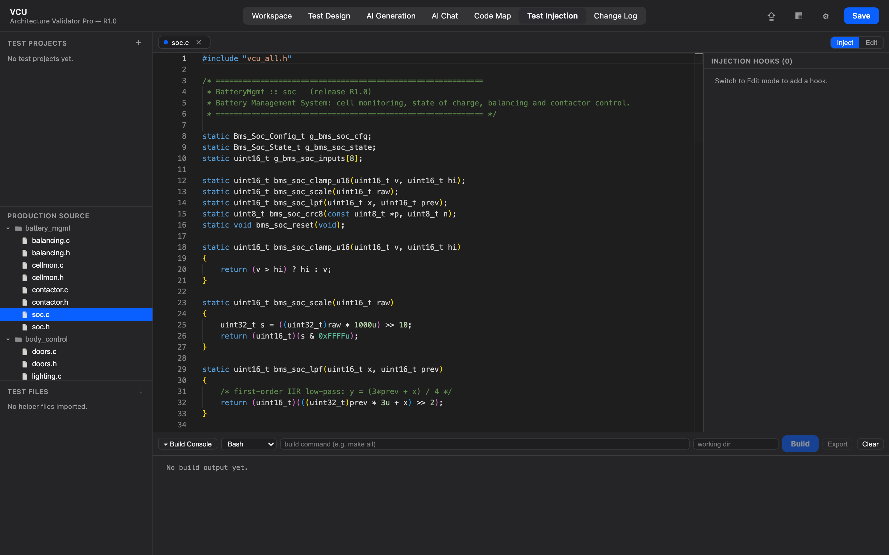

# 11. Test Injection

[← Change Log](10-change-log.md) · **Test Injection** · [Guide home](README.md)

---

The **Test Injection** view lets you splice extra C code — instrumentation, stubs, a test harness — into your firmware **without ever editing the real source files**. Your edits are saved as *hooks* in the project and applied only to generated copies, so your originals stay clean.

> 💡 **Preferences → Tutorials → Test Injection workflow** runs through the whole flow on a simulated screen.

## How it works

A **hook** is a snippet of C anchored to a location in a production source file. Crucially, hooks anchor to the **text of the surrounding lines, not line numbers** — so a hook re-finds its spot even if the upstream source shifts later. Nothing is written to the real file; the hook lives in the project and is applied only when you export.

## The layout

- **Sidebar (left):**
  - **Test Projects** — a container for one set of hooks, helper files, and build settings. Keep several (e.g. a coverage build vs. a unit harness); select one to make it active.
  - **Production Source** — your firmware's real source for the active release (read-only). This is what you inject *into*.
  - **Test Files** — helper `.c/.h` files you import to ride along with the export.
- **Centre:** the source editor with an **Inject / Edit** mode switch, and a **Build Console** with **Build** and **Export**.
- **Right:** the snippet editor for the selected hook.

## The workflow

1. **Create a test project** with **＋** next to *Test Projects*, and select it.
2. **Open a production source file** from the *Production Source* list — it opens in the centre editor in **Inject** mode (a safe preview).
3. **Switch to Edit**, place your cursor where the code should go, and click **＋ Hook at cursor**.
4. **Write the snippet** in the right-hand editor and **Save** — it appears inline in the preview (highlighted green) at the anchor point, while the real file on disk stays untouched.
5. *(Optional)* **Import helper files** (`.c/.h`) under *Test Files* if your injected code calls mocks or a harness. They're kept separate from production code.
6. **Export** and choose how:
   - **Modified** — writes only the files that have hooks.
   - **Reconstruct** — writes the whole source tree with hooks applied.

   Point it at an output folder and you get build-ready code — your originals stay clean.

Because hooks live in the project (not the files), you can tweak or remove them any time and re-export.

---

[← Change Log](10-change-log.md) · [Guide home](README.md)

## Test Builds

**Test Builds**, at the top of the Test Injection tab, prepares named builds for testing on a real ECU, such as `Watchdog build`, builds them one after another overnight, and swaps them into the folder your debugger points at. You keep one mapped folder instead of several copies of a release.

Test builds aren't compared with Main or analysed. They can hold code that a normal pipeline would fail, such as a `while(1)` for a watchdog test or an MPU violation, so a build is judged only on whether its build command succeeded. They never change the release's symbols, Code Map, call graph or test results.

### Set up a build

1. Select the release in the table. Builds always belong to one release, so R2 needs its own builds even if it uses the same test project.
2. Under **Builds for the selected release**, add a build with a name and a test project.
3. Click **Edit** and set the build command, clean command, terminal, working directory, source folder and build output folder. The clean command matters: without it, objects from the previous build can end up in this one.
4. Under **Tracked files**, choose what to keep: files or folders, with a role of **Flash**, **Symbols**, **Source** or **Objects**. Folders accept patterns such as `**/*.hex`. The project-wide list applies unless a build has its own. If you don't track any Source files, the files your hooks change and your helper files are kept.

Track your `.o` files with the **Objects** role. They're kept for Main only, so you can import them later from clean output.

### Clean release data first

Architecture testing needs the release's clean source and `.o` files, so they should be imported before injected code exists. If either is missing, a run or **Export** tells you which one and offers **Continue anyway**, which is recorded under your name. You might choose this because the release hasn't been built yet. Importing later is never blocked: use **Import from Main capture** so that no test code gets in. A release with no source can still build Main, but builds with hooks are skipped.

### Run overnight

Tick the builds and click **Check and run…**. The app lists anything that would fail, and you can drop those builds and start the rest. The run then:

- builds **Main** first if the release has no complete Main capture yet. If Main fails, that release's test builds are skipped, because there'd be nothing clean to switch back to
- for each build, applies its hooks, runs the clean and build commands, saves the log and captures the tracked files
- puts your source folder back after each build, so one build's hooks can't reach the next
- carries on if a build fails, and marks a build **Incomplete** if a tracked file is missing

The run holds the edit lock and keeps the machine awake. If the app or machine stops, the next start offers **Resume**, which restores the source folder and continues from the first unfinished build.

### Switch the mapped release

Under **Mapped release**, choose the folder your debugger points at. It's saved for you on this PC, because paths differ between PCs. Pick a build and click **Switch**, and the app tells you when it's finished. Then flash from your debugger as usual.

- Only files that differ are transferred, and files the app didn't place there are left alone.
- If a file was changed outside the app, such as by a manual rebuild, you're asked before it's overwritten.
- If the debugger has a file open, the app names it. Close the debugger and switch again.
- If the NAS drops during the download, the mapped folder doesn't change.
- If a switch is interrupted while files are being replaced, the next start offers to finish it or go back.

Switching back to **Main** is the same action, and it doesn't need the edit lock. If you change the release in the table, that release's builds are listed instead, and the mapped folder stays as it is. The app warns you if it holds a build from another release.

### Where binaries are kept

Binaries are stored next to the project in `Project.arch.binaries/`, not inside it and not on each PC. Each file is stored once, so a file that's the same in Main and in a test build takes no extra space. **To copy a project elsewhere, copy this folder too.** Deleting a build keeps its files until you click **Clean up** under **Binary store**.
