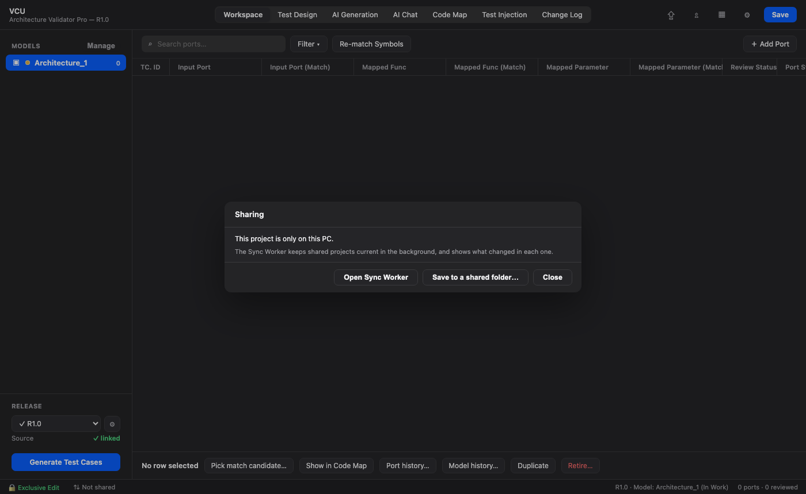

# 13. Shared Projects & Sync

[← Test Builds](12-test-builds.md) · **Shared Projects & Sync** · [Next: Pipeline CLI →](14-pipeline-cli.md)

---

A team can keep a project on a network share, such as a NAS. The **Sync Worker** keeps your local copy and the shared copy in step. You work from your own disk, so the app stays fast, and only the changed parts travel.

> 💡 **Preferences → Tutorials → Shared projects & sync** walks through it on a simulated screen.

## The Sync Worker

The Sync Worker is a small separate applet with a tray icon (a menu bar icon on macOS). It doesn't need the app. Turn on **Start at login** in its menu, and it quietly keeps your shared projects current in the background from the moment you sign in. The icon turns while data is moving, and changes colour only when a project needs you.

Its menu has:

- **Open Sync Worker…** — your shared projects and what changed in each.
- **Sync now** — check straight away.
- **Start at login** — run it whenever you sign in.

## Share a project

In the **Workspace**, click the sync entry in the status bar at the bottom (it says **Not shared**) and choose **Save to a shared folder…**. A progress card shows each step, and you stay in the project throughout.

There are two other ways to start:

- A project created on a network path is shared straight away.
- For a database someone copied there by hand, use **Add database…** in the Sync Worker, or simply open it.

## Working on a shared project

- **Edit:** opening for editing locks the shared project under your name and brings your copy up to date first. Other users can still view it.
- **Publish:** **Save** sends your changes. Teammates then never receive half-finished work. A finished overnight [test build](12-test-builds.md) run publishes by itself.
- **Receive:** changes from others arrive by themselves within about 30 seconds, whether or not the app is open. If the project is open, the app shows **Syncing changes from** and the user's name while they're applied.
- **Close:** the lock is released once your last changes have been published. The Sync Worker finishes this even if the app has closed.

The Workspace status bar shows where things stand, such as **Synced** and the time, or **Offline**.

## What changed, and by whom

Click **Open Sync Worker…** in the tray menu to see your shared projects and each one's changes, such as `alex → Release 2.1 → Code Map`, filtered by section. This is kept in the Sync Worker so that it doesn't clutter the app or the ASPICE change history, and it works with the app closed.

## A lock left behind by a crash

If someone's PC stops while they're editing, their lock stays behind. A live session updates its lock every minute, so the Sync Worker can tell how long a lock has been silent. After 10 minutes of silence you can open the project for editing straight away. Nobody has to wait, and a wrong clock on either PC can't free a lock that's in use. Without the Sync Worker running, the app has to watch the lock itself for those 10 minutes.

## When something goes wrong

| Situation | What you'll see |
|---|---|
| The NAS can't be reached while viewing | You keep working from your copy, and the status bar shows when it last synced. |
| The NAS can't be reached while editing | The session stays open, and your edits are published when it comes back. |
| Someone took over after you were offline for more than 10 minutes | Your work is saved next to the shared project as `Project (conflict <user> <date>).arch`, and your session becomes view-only. Nothing is merged automatically. |
| The shared copy is damaged | Sync stops for that project. **Republish from this copy** replaces it from your complete local copy, and the damaged file is kept beside it. |
| PCs run different app versions | Sync stops for that project until everyone has updated. |

**Sync now** checks straight away, and gives a stopped project another try once you've fixed what stopped it.

## Encrypted projects

Encrypted projects sync too. The Sync Worker copies stored values as they are, so it never sees your master password.

## Stop sharing a project

**Stop tracking** in the Sync Worker removes a project from the list and leaves both copies in place.

---

[← Test Builds](12-test-builds.md) · [Guide home](README.md) · [Next: Pipeline CLI →](14-pipeline-cli.md)
