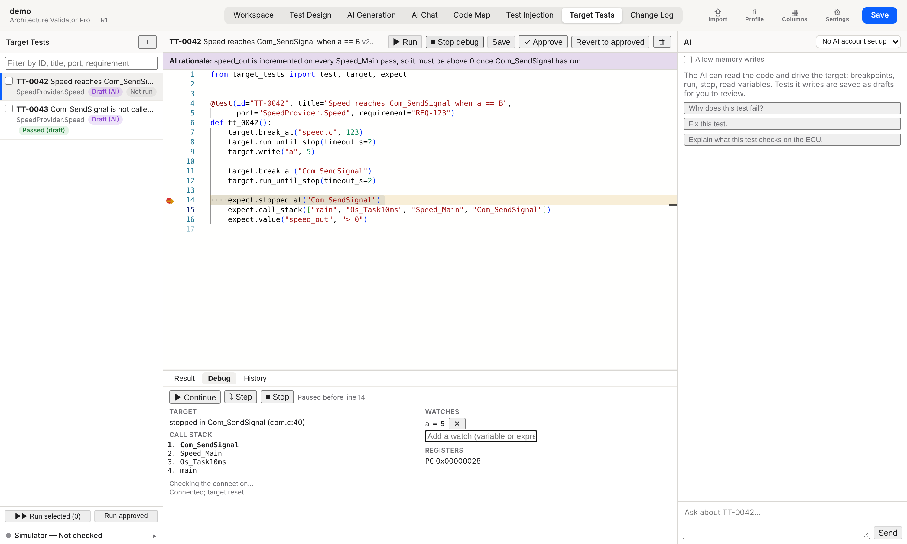

# 15. Target Tests

[← Pipeline CLI](14-pipeline-cli.md) · **Target Tests** · [Guide home](README.md)

---



**Target Tests** checks the architecture on the real ECU. A static check shows that a function *can* be reached. A target test shows that it *is* reached, under the conditions that make it happen. Those conditions can be an `if` on a variable, a macro value or a state set over the bus.

The AI drives the debugger (winIDEA) to find out how to reach a function, and writes down what worked as a test script. You review the script, correct it if needed and approve it. Approved tests then run without the AI, so the same test gives the same result every time.

## The screen

| Left | Middle | Right |
|---|---|---|
| The tests, grouped into test suites, with their approval status and last result. Tick tests to run several at once. The connection settings are at the bottom. | The selected test's script. Below it are the **Result**, **Debug** and **History** tabs. | The AI. It can read the code and control the target. |

## Test suites

Every test belongs to a **test suite**, and a test suite is an architecture model. The list shows one suite per model, in the architecture's order, with the number of tests and a summary of their last results. A model with no tests is listed too, so you can see what isn't tested yet.

| On a suite | What it does |
|---|---|
| Click the name | Folds or unfolds the suite. |
| The checkbox | Ticks or unticks all of the suite's tests. |
| **▶** | Runs the suite's approved tests. |
| **＋** | Creates a test in this suite. The **＋** at the top of the list creates one in the active model's suite. |

A test the AI writes goes into the suite of the model it checks. The AI names that model when it saves the test. If it doesn't, the model of the test's port is used, and after that the model of the selected test or the active model.

To move a test, pick another model in the box next to the test's title. Moving a test doesn't change its approval. The suite is kept in the project and not in the script, so renaming a model keeps its tests. A deleted model's suite stays in the list while it still has tests, and tests whose model is gone for good appear under **No model** until you move them.

## A test script

A test is a short Python script that uses only the `target_tests` API:

```python
from target_tests import test, target, expect

@test(id="TT-0042", title="Speed reaches Com_SendSignal when a == B",
      port="SpeedProvider.Speed", requirement="REQ-123")
def tt_0042():
    # The call sits behind `if (a == B)` in speed.c:123; B is 5.
    target.break_at("speed.c", 123)
    target.run_until_stop(timeout_s=2)
    target.write("a", 5)

    target.break_at("Com_SendSignal")
    target.run_until_stop(timeout_s=2)

    expect.stopped_at("Com_SendSignal")
    expect.call_stack(["main", "Os_Task10ms", "Speed_Main", "Com_SendSignal"])
    expect.value("speed_out", "> 0")
```

| `target.` | What it does |
|---|---|
| `break_at(location, line=None)` | Sets a breakpoint on a function, or on a file and line. |
| `run_until_stop(timeout_s=2)` | Runs until a breakpoint stops the target. Returns `False` on a timeout and stops the target. |
| `run_to(location, line=None, timeout_s=2)` | `break_at` followed by `run_until_stop`. |
| `step(kind="over")` | Steps `over`, `into` or `out`. |
| `break_on_write(variable)`, `break_on_read(variable)`, `break_on_access(variable)` | Stops when the variable is written, read or either. Use it to test a variable port: run, then check who accessed it. The probe has only a few of these. |
| `read(expr, frame=0)` / `write(expr, value)` | Reads or writes a variable. `frame=1` reads the caller's locals and arguments, `frame=2` its caller's. |
| `call_stack()` / `status()` | Gets the call stack (outermost first), or where the target is: function, file and line. |
| `symbol(name)` | Gets the address, size and type of a variable or function in the program on the target. |
| `read_register(name)` / `read_memory(address, size)` | Reads a core register, or up to 1024 bytes at an address (as hex text). |
| `call(function, *args)` | Runs a function on the target and returns what it returned. The arguments must be simple types. It changes the target, like `write`. |
| `clear_breakpoints()`, `wait(seconds)` | Clears every breakpoint, or lets the target run for a while (10 s at most). |

| `expect.` | Passes when |
|---|---|
| `stopped_at(function)` | The target is stopped in this function. |
| `call_stack(frames, exact=False)` | These frames appear in this order. With `exact=True`, nothing else appears. |
| `value(expr, condition)` | The value matches the condition, for example `5`, `"> 0"` or `"!= 0x10"`. |
| `not_reached(location, line=None, timeout_s=2)` | Running doesn't stop there within the timeout. |
| `true(condition, message="")` | A condition you compute in the script is true. |

A failed expectation doesn't stop the test, so you see every result. A test passes when all its expectations pass. A test with no expectations fails.

Scripts may only use this API, plain values, and simple `if` and `for` statements. Imports, file access and `while` loops aren't allowed. The editor marks any line that breaks these rules, and a test with such a line can't run or be approved.

## Approval

| What happened | Status |
|---|---|
| The AI wrote a new test | **Draft (AI)**. Click **✓ Approve** once you've checked it. |
| The AI proposed a change to a test | The test keeps its status. The change appears as a diff, with the AI's reason above it. **Accept change** makes it a draft, and approving it is a separate step. **Reject** discards it. |
| You edited a test and clicked **Save** | **Approved** by you, straight away. |
| A new release, Code Map or source | No change. A test stays approved until the AI changes it. |

**Revert to approved** brings back the last approved version. Each version is kept: the **History** tab shows who wrote each one (AI, manual or revert) and which version is approved.

A draft can be run too, but its result is labelled **(draft)** and isn't a verdict.

## Running tests

**▶ Run** runs the selected test. **Run selected** runs the ticked tests, and **Run approved** runs every approved test. Every run:

1. **Checks the connection first:** winIDEA is running with the workspace open, the SDK matches winIDEA, the debugger can stop the target, and memory can be read. If any check fails, nothing runs, and the message names the failed check.
2. **Resets the target before each test**, so no test depends on an earlier one.
3. **Stops a test that runs too long** (the timeout is in the connection settings) and records it as an error.

The **Result** tab shows each step with its line and its result. Click a row to jump to that line. Results are kept with the version that ran, the user, the time and the winIDEA version.

## Debugging a test

Click in the editor's gutter to set breakpoints, then click **🐞 Debug**. The script in the editor runs, saved or not, and pauses before each line with a breakpoint. With no breakpoints, it pauses on the first line. While it's paused, the **Debug** tab shows:

- where the target is stopped, and its call stack;
- your **watches**. Type a variable and press Enter; the values refresh straight away;
- the registers.

**Continue** runs to the next breakpoint, **Step** pauses on the next line, and **Stop** ends the session. Debug runs aren't recorded.

## The AI

The AI in the right pane has the usual code tools and also controls the target: it can set breakpoints, run with a timeout, step, read the call stack and variables, and try a script. It can also stop on a read or write of a variable, read a caller's arguments, look up a symbol, read registers and memory, and check that the ECU runs the program winIDEA is set up to download. For example:

- *"Generate a test that Com_SendSignal is reached from main."*
- *"How can I test requirement REQ-123 on the ECU?"*
- *"Who writes speed_out? Write a test for it."*
- *"Why does this test fail?"* or *"Fix this test."*, about the selected test.

When a function isn't reached, the AI reads the code around the call and works out the macro values from the source. It then changes the variable, runs again and checks the call stack. It saves what worked as a **draft** with its reasoning, which appears above the script. A change to an existing test arrives as a **proposal**.

Safety:

- **Allow memory writes** is off by default. Until you switch it on, the AI can't change variables or call a function on the target.
- **Allow flashing** is off by default. With it on, the AI can program the ECU with the files winIDEA is set up to download, which is the mapped build, and only when you ask it to.
- The AI has no erase or option-byte tools, and every run has a time limit.
- If a condition can't change while the ECU runs, the AI tells you a rebuild is needed instead of working around it. This covers an `#if`, a constant the compiler folded away, and code missing from the binary. A [Test Build](12-test-builds.md) with the right define is the way to test it.
- Every action the AI takes on the target is logged.

## Connection settings

Open them at the bottom of the left pane. They're saved for you on this computer, because paths differ between PCs.

| Setting | |
|---|---|
| **Target** | **winIDEA**, or **Simulator** to try the view without an ECU. |
| **winIDEA folder** | The winIDEA installation. Its own `isystem.connect` SDK is used, so the SDK always matches winIDEA (9.21.110–9.21.121 and newer). |
| **Workspace** | The winIDEA workspace. Leave it empty to use the instance you used last. |
| **Probe symbol** | A symbol the connection check reads to prove memory access works (`main` by default). |
| **Test timeout** | How long one test may run, not counting debug pauses. |

**Check connection** runs the same checks as a test run and lists each result.

> ⚠ **Stopping a live ECU.** While the target is stopped at a breakpoint, watchdogs, OS deadlines and bus timeouts keep counting. Use a debug build with the watchdog off, for example a [Test Build](12-test-builds.md).

winIDEA runs on Windows only. On Linux and macOS, use the Simulator, or run tests on a Windows bench.
